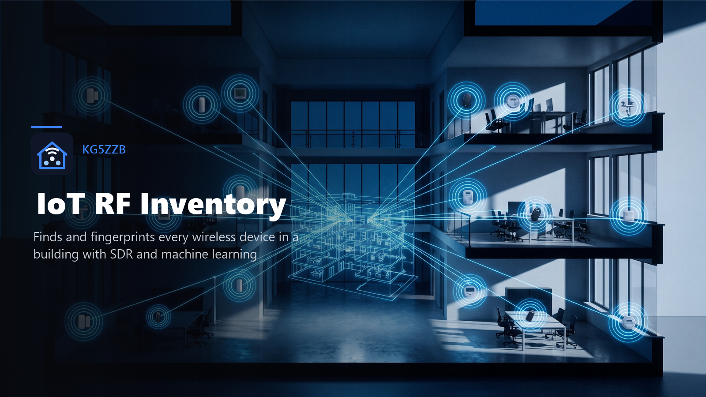
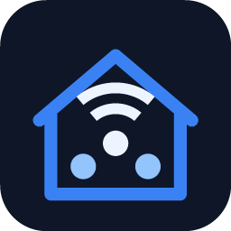
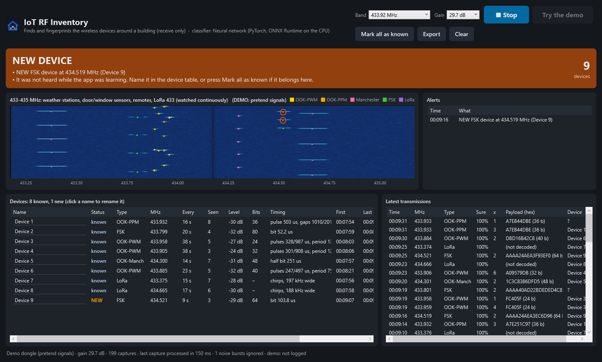

# KG5ZZB - IoT RF Inventory





**Passive sub-GHz IoT device discovery and RF fingerprinting for Windows with a low-cost RTL-SDR: every burst on 315 / 433.92 / 868 / 915 MHz is detected, demodulated to bits, classified by a neural network (OOK-PWM, OOK-PPM, OOK-Manchester, 2-FSK, LoRa) and grouped into devices by unsupervised clustering, with NEW DEVICE alerts.**

Point it at a building and it builds an **inventory of the wireless devices transmitting there**: weather stations, door and window sensors, remotes, tire-pressure-style sensors, meters, LoRa nodes. For each device it shows the carrier frequency, modulation and line coding, symbol timing, packet length, how often it transmits, signal strength and the latest payload in hex. After a learning period it raises an alert when a transmitter appears that was not there before.

It is **receive-only**: it never transmits, replays or jams anything, and it does not interpret any product's protocol. It shows raw bits.

> **Status: v0.1.0.** Continuous and swept capture, burst detector, channeliser, OOK (PWM / PPM / Manchester) and 2-FSK demodulators, neural-network modulation classifier (ONNX), weighted-DBSCAN device fingerprinting, new-device alerts, editable device names, CSV / JSON export, JSON Lines event log and a built-in demo all work. 25 automated tests.



---

## What it does

### 📡 Listens to the sub-GHz ISM bands
| Band | How | Typical devices |
|---|---|---|
| 433.92 MHz | One 2 MHz view, watched without gaps | Weather stations, door/window sensors, remotes, LoRa 433 |
| 315 MHz | One 2 MHz view, watched without gaps | Remotes, garage openers, tire-pressure-style sensors |
| 868 MHz (863-871) | Swept in 4 steps of 2 MHz | LoRaWAN EU868, alarm sensors, meters |
| 915 MHz (902-928) | Swept in 13 steps of 2 MHz | LoRaWAN US915, utility meters, sensors |

- RTL-SDR at **2.4 MS/s**. Single-view bands are processed as **overlapping 800 ms windows** that advance by 500 ms; a burst is reported by the window it starts in, so packets that cross a window edge are still decoded whole.
- **Burst detection** on a short-time FFT spectrogram (256 points, 9.4 kHz bins, 107 µs frames): per-bin noise floor, threshold, connected components, and joining of pulses on the same frequency less than 15 ms apart, so an OOK pulse train and its repeats become one transmission.

### 🔬 Demodulates every burst to bits
- **Channeliser:** mix the burst to 0 Hz, two-stage FIR low-pass and decimation (2.4 MS/s to 300 kS/s for narrow signals).
- **Envelope (OOK):** threshold with hysteresis half-way between the noise and signal levels, glitch removal, then pulse and gap timing with about 3 µs resolution. Packets are split at separator gaps.
- **Instantaneous frequency (FSK):** `angle(x[n] * conj(x[n-1]))`, sliced half-way between the two tones; the bit time is recovered from the run lengths.
- **Line decoders:** PWM (long pulse = 1), PPM / pulse-distance (long gap = 1), Manchester (IEEE 802.3: high-then-low = 0; both bit alignments are tried), 2-FSK NRZ (higher tone = 1).
- **Measurements:** carrier frequency (refined from the demodulated signal to about 1 kHz), bandwidth, symbol rate, pulse/gap durations, packet length, repeats, RSSI (dBFS) and SNR.
- **Repeat grouping:** identical packets inside one transmission are counted (x4), not listed four times.

### 🧠 Machine learning, two parts
1. **Supervised: modulation / line-coding classifier.** A PyTorch neural network (17 → 64 → 32 → 6) reads 17 features measured on each burst (pulse/gap statistics, period regularity, pulse-gap correlation, frequency bimodality, chirp slope, ...) and picks one of **Noise, OOK-PWM, OOK-PPM, OOK-Manchester, 2-FSK, LoRa**. Its answer selects the decoder. It is exported to ONNX and runs in C# with **Microsoft.ML.OnnxRuntime** on the CPU (microseconds per burst).
2. **Unsupervised: device fingerprinting.** Each transmission becomes a 15-number fingerprint (carrier frequency, pulse and gap durations, pulses per packet, bits, RSSI, bandwidth, modulation). Each number is scaled by its typical *within-device* spread, so two transmissions of one device are close. A transmission joins the nearest known device; otherwise it waits in a pool clustered with **weighted DBSCAN** (identical repeated packets count as extra evidence). A dense cluster becomes a device; the number of devices is never given in advance.

### 🚨 Inventory, alerts and integration
- **Learning period** (3 minutes by default, 60 s in the demo): devices heard then are the site's baseline. A device that appears later raises **NEW DEVICE** (banner, sound, alert list, red ring on the waterfall).
- **Device table:** name (click to edit), status (known / NEW), type, MHz, how often it transmits, transmissions, level, bits, timing, first and last seen, last payload.
- The device list is saved per band in `%APPDATA%\KG5ZZB-IoT-RF-Inventory\`, so the baseline survives a restart. **Mark all as known** accepts the current devices.
- **Export** writes the inventory as CSV and JSON. Every transmission and new-device event is appended as one **JSON Lines** record to `%APPDATA%\KG5ZZB-IoT-RF-Inventory\events.jsonl`, ready for a SIEM, a log shipper or a script.

### 🎬 Try it without hardware
**Try the demo** (or start with `--demo`) plays a built-in building scenario on 433.92 MHz: two weather sensors (PPM and PWM), a door/window sensor, a garage-remote-style transmitter, a tire-pressure-style FSK sensor, an energy-monitor-style Manchester sensor and two LoRa nodes. The app learns them for 60 seconds; at 75 seconds an **unknown FSK device** switches on and is flagged. The demo also has devices on 315, 868 and 915 MHz.

---

## How the machine learning is built

```
DatasetGen classify (C#)        train.py (Python, PyTorch)              App (C#, ONNX Runtime)
render random OOK/FSK/LoRa  ->  standardise 17 features            ->   embedded modulation_classifier.onnx
run the app's real receive      17 -> 64 -> 32 -> 6 MLP, class weights  CPU inference per burst
chain, write features           early stopping, held-out test set       picks the line decoder

DatasetGen cluster (C#)
device populations -> full receive chain -> fingerprints -> online inventory / DBSCAN / k-means / frequency-only -> ARI, purity
```

- **Data:** a C# dataset generator renders randomised transmissions at 2.4 MS/s (OOK PWM / PPM / Manchester with random timings, bit counts and repeats; 2-FSK from 2.4 to 50 kbit/s; LoRa SF7-SF9 at 125/250/500 kHz; carriers, clicks and blips) at 8-32 dB SNR, then runs **the same spectrogram, detector, channeliser and demodulators the app uses**. Training seed 1 (13,411 bursts), test seed 2 (4,562 bursts, never used for training).
- **Classifier on the held-out test set:** **97.6% accuracy, macro F1 0.974**, against **69.7% / 0.687** for the hand-written rule baseline in `RuleModulationClassifier`.
- **Fingerprinting** (5 populations of 30 devices x 6 transmissions, several devices per model):

| Method | Adjusted Rand index | Purity |
|---|---|---|
| **Online inventory (the app)** | **0.904** | **0.993** |
| Batch weighted DBSCAN | 0.897 | 0.987 |
| k-means, told the true number of devices | 0.770 | 0.822 |
| Frequency only (what a spectrum view shows) | 0.123 | 0.154 |

Per-class precision/recall, the confusion matrix and the method details are in **[docs/MODEL.md](docs/MODEL.md)** (the model card).

## Architecture

| Layer | What it does |
|---|---|
| Hardware | P/Invoke bindings to librtlsdr, async streaming, retune with stale-buffer discard, USB error retries, WinUSB driver check |
| Capture | Overlapping windows on single-view bands, stepped sweep on wide bands, stream clock |
| DSP | FFT, FIR design, decimating filters, NCO mixer; spectrogram, noise floor, connected components, pulse-train joining |
| Demodulation | Channeliser, envelope and FM demodulators, pulse timing, feature extraction, PWM / PPM / Manchester / FSK decoders, hex |
| Machine learning | Dataset generation, PyTorch training, ONNX export and inference, rule baseline; DBSCAN, k-means, adjusted Rand index, purity |
| Inventory | Fingerprints, online device matching and clustering, intervals, new-device alerts, CSV / JSON export and reload, JSON Lines event log |
| Pipeline | One capture in, classified and decoded transmissions out (shared by app, demo, tests and tools) |
| Demo engine | OOK line encoders, FSK / LoRa / OOK generation, device models, demo scenario, demo dongle |
| UI | WPF: status banner, waterfall with classified ticks, alerts, editable device table, transmission log |

## Requirements
- Windows 10 or 11, 64-bit.
- An RTL-SDR dongle (RTL2832U + R820T/R828D tuner) with the WinUSB driver (install once with [Zadig](https://zadig.akeo.ie/)). Tested with a Nooelec NESDR SMArt v5.
- An antenna for the band you listen to.

## Recommended hardware

| Item | What to use | Why |
|---|---|---|
| **SDR dongles** | **1** RTL-SDR is enough: the app switches between 315, 433.92, 868 and 915 MHz and sweeps the wide bands by itself. | A **2nd dongle** is optional: run a second copy of the app (it takes the next free dongle) to watch 433 MHz and 915 MHz at the same time instead of switching. |
| **Antenna** | A **wideband discone** (about 25 MHz to 1.3 GHz), or separate band antennas: **433 MHz** (quarter-wave elements about 17 cm) and **915 MHz** (about 8 cm). | The discone covers all four ISM bands with one antenna. Place it centrally in the building so devices in every room are in range. |
| **Coax** | Short, low-loss coax (for example RG-6 or LMR-240 class) between antenna and dongle. | At 868-915 MHz long thin coax loses a lot of signal. |

## Scope
- An RTL-SDR covers about 24 MHz to 1.7 GHz and sees 2.4 MHz at a time. The 868 and 915 MHz bands are swept, so a short transmission can be missed while the receiver is on another step; Wi-Fi, Bluetooth and other 2.4 GHz devices are out of range.
- Receive-only. The app records metadata and raw bits; it does not decode or store any product's protocol, and it never transmits. Check local rules before monitoring radio traffic on premises you do not control.

## Source code
This repository is the public showcase: description, results, model card and images.
The source code is private. Technical walkthroughs are available on request.

## License
Copyright (c) 2026 KG5ZZB. All rights reserved. Text and images may not be reused without permission.
